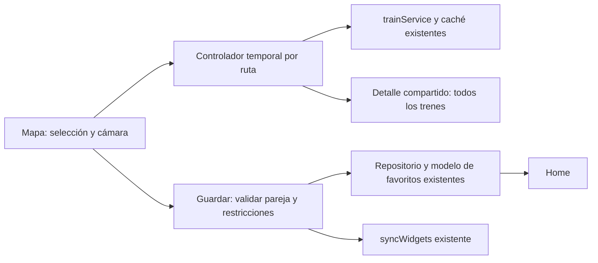

# AndroidMetro 2.0 · mapa nativo L1/L2

Base revisada: `feature/mapa-interactivo-prototipo`, `97c662b`. Rama de trabajo: `feature/mapa-interactivo-android`. El ZIP sin versionar se preservó fuera del checkout en `respaldo-mapa-interactivo-pre-android.zip`, SHA-256 `6ef1c1b4b2642cec1207d9fbe1be6dcfd171cee0ec5ba354b2a102042b5c08fd`.

## Datos y representación

`src/data/metroMap.json` deriva del modelo trazable de fase 2A. Contiene exclusivamente las 42 estaciones de L1/L2 y 41 aristas físicas bidireccionales validadas. Conserva código API, identificador de dominio, ID SVG, fuentes y evidencia original. No hay nodos ZZ*, secuencia L3 ni transbordo CAV/ZZC. CAV permanece como estación compartida de L1/L2. El modelo histórico completo sigue intacto en `prototypes/mapa-interactivo/`.

Nombres visibles de este flujo: MOY = Eliptikoa, DEU = Deusto. No se altera `stations.js`, el código API, los nombres antiguos en otras pantallas ni la persistencia. Las posiciones originales se trasladan 180 unidades hacia arriba y el encuadre se reduce a 2420×560, eliminando el espacio del ramal retirado. Las etiquetas, geometría y selección se renderizan como primitivas SVG independientes.

`mapModel.js` calcula el camino físico sobre las aristas validadas y resuelve selección y áreas de pulsación de 48 dp, después de la transformación de cámara. Si varias estaciones están dentro del objetivo, abre una lista nativa de candidatas. El mapa completo orienta; la ampliación permite leer los nombres. Los campos de origen/destino ofrecen búsqueda por nombre sin depender de un toque preciso. O/D y color identifican ambas selecciones.

## Dependencias y gestos

Se conservan Expo 55.0.2, RN 0.83.2, React 19.2.0, Fabric y Hermes. Se añaden únicamente las dependencias directas `react-native-svg` 15.15.3, Gesture Handler 2.30.0, Reanimated 4.2.1 y Worklets 0.7.2, más sus transitivas. Las versiones coinciden con `node_modules/expo/bundledNativeModules.json`; la matriz instalada de Reanimated admite RN 0.83 / Worklets 0.7.x. Fuentes: [SVG SDK55](https://docs.expo.dev/versions/v55.0.0/sdk/svg/), [Gesture Handler SDK55](https://docs.expo.dev/versions/v55.0.0/sdk/gesture-handler/), [Reanimated SDK55](https://docs.expo.dev/versions/v55.0.0/sdk/reanimated/).

`expo install --check` online recomienda actualmente Expo 55.0.31, status-bar 55.0.6, RN 0.83.10 y Worklets 0.7.4. No se aplicó esa actualización general. La comprobación offline utiliza el catálogo local y no detecta discrepancias, aunque advierte que esa validación offline es limitada. La compatibilidad práctica de esta entrega debe apoyarse en la compilación y las pruebas Android registradas, no únicamente en ese comando.

La raíz de Gesture Handler está dentro del modal del mapa. Pan y pinch son simultáneos y compiten con tap; los umbrales evitan seleccionar una estación al arrastrar. Reanimated transforma una vista SVG memorizada desde el hilo UI; sólo la selección llega a JS, sin reconstruir estaciones por cada frame. Se limita la cámara entre encuadre completo y escala 2; los controles ofrecen acercar, alejar y recuperar encuadre. No hay WebView ni motor geográfico.

## Preservación y compilación

La entrada Mapa es adicional a la home. El controlador de favoritos se pausa al abrir el mapa y se reanuda al volver. Los registros de widget y ConfigScreen se conservan. No hay cambios de iconos, credenciales de distribución ni aplicación original.

Se utiliza `scripts/compilar-pruebas.ps1` sin `--clean`, entorno aislado existente, `com.metrobilbao.widget.pruebas` y exclusivamente el keystore de pruebas. Todas las instalaciones y acciones Android se dirigen explícitamente a `emulator-5556`. No se publica ni se hace push/merge. Los APK de recuperación y fase 1 siguen separados.

## Validación por etapas

La integración de consultas se habilita después de comprobar el primer APK de mapa nativo en Android. Los resultados, capturas, artefactos y pendientes se registran en los apartados siguientes al completar cada etapa.

### Etapa A completada antes de conectar consultas

APK de recuperación nativo: `C:/Users/W11/AMetro/artifacts/androidmetro-mapa-stage-a-test.apk`, SHA-256 `c7d84a2ca84cc0c29002b2f52d18d50f0e3d14fdde292b3fa4ae2d2af5c9d0fa`. Incluye únicamente la selección del mapa, sin consultas desde él. Firma de pruebas existente verificada. La primera compilación permitió detectar y corregir el centrado de zoom antes de este APK.

Comprobaciones reales en Android API36: vista completa L1/L2, bifurcación, ambos ramales, ausencia L3; pellizco con MotionEvents de dos punteros Android, arrastre, ampliación/alejado/encuadre, pulsaciones Erandio/Urbinaga, intercambio, reset, búsqueda Deusto y Eliptikoa, toque ambiguo con candidatas y selección Plentzia. Fuente 100/150 %, retrato 1080×2400 y 900×2000 a 420dpi, paisaje 2400×1080. Se habilita la orientación `default` de Expo para permitir la rotación requerida; listas y home conservan su funcionamiento. Cambiar font_scale desde ADB recrea la actividad en este entorno; se reabre Mapa para probar la nueva escala.

Gfxinfo, tras reset y una muestra de pellizco/arrastre: 57 frames, mediana 8 ms, p90 17 ms, p95 18 ms, 4 frames tardíos (7,02 %), ningún frame de hilo UI lento. Es una muestra corta del emulador, no una garantía de 60fps en móviles. Archivo bruto `C:/Users/W11/AMetro/evidencias/mapa-android/gfx-stage-a.txt`.

Home con tres trenes y acceso a ocho resultados reales comprobada. Widget existente muestra STZ/MOY, ocho trenes y colección desplazable. Persistencia, migración, diez favoritos, consultas y aislamiento pasan los scripts de regresión. Los 1722 pares dirigidos del grafo tienen camino físico; esas pruebas no equivalen a 1722 consultas reales.

Dos intentos iniciales del controlador externo de pellizco fallaron (argumento PowerShell y API InputManager sin contexto); se corrigió el controlador para InputManagerGlobal y CLASSPATH. No eran fallos de la aplicación y no se cuentan como validaciones positivas. Algunas capturas inmediatas durante repintado Android eran incompletas; se conservan fuera del repositorio como registro bruto y se seleccionan capturas estables.


### Etapa B: consultas y favoritos

La etapa B comienza después del commit `34fc89a`, que deja un APK de selección y gestos comprobado sin conectar consultas. El commit `71e11fe` incorpora los servicios del mapa y la reutilización del detalle. Las últimas correcciones ajustan la etiqueta Etxebarri, separan el distintivo L1 de Ariz, hacen desplazable el formulario de alias y aplican al enfoque de estaciones los mismos límites de cámara que al arrastre. No hay cambios funcionales del widget.

`MapScreen` conserva selección y valores Reanimated al presentar el modal de resultados. `mapQueryController` coordina consultas temporales mediante una clave origen/destino y una generación. Cambiar la selección limpia la entrada; una respuesta tardía de otra ruta se descarta. Sólo acepta caché con la misma clave y conserva sus trenes si falla el refresco, mostrando error y aviso de datos anteriores. Una respuesta vacía válida reemplaza los resultados anteriores. Pausa al cerrar el mapa o pasar a segundo plano. No introduce favoritos ficticios ni una segunda caché.

`TrainComponents` extrae la presentación de la home anterior. `TrainDetail`, `TrainRow`, `DataStatus` y la interpretación de hora/vagones/minutos sirven a ambos flujos. La home sigue recortando únicamente su vista previa a tres; el detalle usa la lista completa del servicio. El mapa pasa sus nombres Eliptikoa/Deusto, mientras que los favoritos y pantallas existentes conservan el catálogo previo. Las direcciones anunciadas por la API se muestran tal como las interpreta el servicio existente.

`saveMapFavorite` usa `upsertFavorite`, `loadFavorites` y la transacción serial `changeFavorites` existentes. Comprueba duplicados y capacidad antes de consultar; valida la pareja concreta mediante `queryTrains` y vuelve a comprobar las restricciones dentro de la transacción, ante escrituras concurrentes. El alias es opcional. Un error de consulta conserva el borrador y bloquea el guardado. Una respuesta vacía válida permite guardarlo, como el flujo existente. Tras persistir llama a `syncWidgets`; un fallo exclusivo de notificación informa de que el favorito sí se guardó. La home recarga el documento al volver del mapa. Se bloquea Atrás durante la escritura.



La conexión resaltada es física. Por ejemplo, PLE/BSR respondió con trenes anunciados hacia Etxebarri: la pantalla conserva ese dato, sin transformarlo en un tren directo a Basauri ni calcular transbordos operativos.

## APK final y recuperación

Entrega: `C:/Users/W11/AMetro/artifacts/androidmetro-mapa-android-test.apk` (78 688 820 bytes). SHA-256:

```text
f8504a3977450a54e02b0bceb4141071318b865042dbb599547f14ff07d34b2c
```

ApplicationId comprobado en el APK y en Android: `com.metrobilbao.widget.pruebas`; versionCode 1, versionName 1.0.0, minSdk 24, target/compileSdk 36. APK release autónomo con bundle Hermes incluido, 2 142 216 bytes; no requiere Metro ni servidor del prototipo. Contiene cuatro ABI: arm64-v8a, armeabi-v7a, x86 y x86_64. Sólo se probó x86_64 en este emulador.

`apksigner verify --verbose --print-certs` confirma firma v2 válida, un firmante, certificado de pruebas `CN=AndroidMetro pruebas, OU=Baseline, O=AndroidMetro, C=ES`, SHA-256 `5822756d7982c9c612d283f007d55f08e62b7a4224cc9b5b9409b1297891026d`. No se usan credenciales de distribución. Los 196 PNG/WebP originales dentro del APK de consulta permanecen idénticos byte a byte en el APK final; iconos y recursos originales no se sobrescriben.

Se conservan el APK de consulta previo, el APK A y el candidato B en `C:/Users/W11/AMetro/artifacts/`. Candidato B: SHA-256 `a062c1ec4575be48dd0715b4f74a9685478b28fc7872e2a5d8227b0d110c6e85`. Logs de compilación, incluyendo `build-mapa-entrega.log`, quedan fuera del repositorio en `C:/Users/W11/AMetro/`. La última compilación incremental termina `BUILD SUCCESSFUL`; Gradle avisa de funciones obsoletas incompatibles con un futuro Gradle 10. No se modifica el entorno recuperado para resolver avisos futuros.

## Validación Android real

Todas las capturas son `adb screencap` sin modificar la imagen. Se prueba AVD AndroidMetro_API36, Pixel 6, Android 16/API36, Google APIs x86_64, 1080×2400, densidad 420dpi (~411dp), y tamaño temporal 900×2000 (~343dp). Los tamaños/orientaciones y fuentes se cambian únicamente en el emulador. Los registros A corresponden al APK A; B al candidato de integración; C al APK con correcciones de etiquetas/formulario; D al APK final identificado arriba. La galería y los registros JSON distinguen estas compilaciones.

| Caso | Evidencia y resultado |
| --- | --- |
| Exclusivamente L1/L2, 42 estaciones, bifurcación y tronco | A01, A08 y D08; modelo sin L3 y sin aristas ocultas. No hay enlace CAV/ZZC. |
| Pellizco/arrastre/encuadre | A07/A08/A20 y registros finales D; inyección de MotionEvents Android de dos punteros, no una simulación de zoom JS. Controles de cámara nativos. |
| Origen/destino por toque y por nombre | A08: Erandio/Urbinaga; A13: búsqueda; A21: toque ambiguo abre candidatas; D19: Deusto/Eliptikoa. |
| Corrección, intercambio, reset | A y D: botones de edición, intercambio real ERA/URB→URB/ERA y reset; no cambia ningún código API. |
| Fuente 100/150 %, retrato/paisaje, ~343/411dp | A13/A15/A16/A20, C01/C02/C03 y D18 en adelante. Controles y formularios accesibles al ampliar fuente, nombres vectoriales legibles con zoom. |
| Consulta L1 | B07, PLE/MOY, ocho resultados reales. |
| Consulta L2 | B09, KAB/BSR, ocho resultados reales. STZ/MOY también comprobada. |
| Consulta entre ramales y cola L2 | B08, PLE/BSR, ocho resultados reales; D02 ERA/URB y D04 URB/ERA, ocho cada una. |
| Tramo común | B10, DEU/CAV, ocho resultados reales; D también prueba Deusto/Eliptikoa. |
| Todos los resultados | B03 y D: lista desplazada hasta sus últimas filas; API real devolvió ocho. El contador no implica que todas las filas quepan en una captura. |
| Volver al mapa | D01/D03: selección, cámara y recorrido conservados; comparación del área [0,488,1080,2140] devuelve igualdad exacta de píxeles. También B01/B04. |
| Guardado con alias y sin alias | B16/C08: Costa y Ramal; D05: URB/ERA sin alias. D06 muestra cuatro favoritos; D07 conserva los mismos tras reiniciar Android. |
| Duplicados y máximo diez | B05/C04: duplicado rechazado; B06: capacidad diez rechazada. Documento del usuario principal conserva diez favoritos. |
| Sin red con caché de la misma ruta | B11: Wi-Fi y datos desactivados, error de conexión, ocho resultados previos DEU/CAV con aviso y hora original. |
| Sin red al cambiar a ruta nueva | B12: ERA/URB no muestra los trenes anteriores de DEU/CAV. Error explícito, sin lista ajena. |
| Recuperación de red | B13: restaurar Wi-Fi/datos y refrescar produce ocho trenes reales ERA/URB. |
| Reinicio y app sin widgets | D06→D07/D08: reinicio Android real y apertura autónoma. Usuario 10 no tiene widgets; conserva Casa, Costa, Ramal y URB/ERA. |
| Home y detalle de favoritos | D09/D17/D18: vista previa tres, detalle ocho, mismos horarios/direcciones/vagones. Home se recarga después del guardado desde mapa. |
| Widget tras reinicio | D10–D16: dos instancias existentes, selector diez favoritos y colección de ocho trenes desplazable; cambiar una a BAR/MOY mantiene la otra en STZ/MOY. Se restaura la primera a CAV/SIN. |

Las consultas reales utilizan exclusivamente la API actual de Metro Bilbao, sin datos inyectados. Son parejas concretas, no una declaración de compatibilidad operativa de todas las combinaciones. La hora de consulta se presenta en Europe/Madrid aunque el reloj de la barra del emulador tenga otra zona; tras reiniciar, Android sincronizó su reloj y las nuevas consultas muestran su nueva hora. No se genera una predicción de viaje.

Comprobación adicional de sincronización real (serie E, mismo APK final): después de probar el usuario 10 sin widgets y su reinicio, se añade un widget temporal y se deja abierto el selector con cuatro favoritos. Desde Mapa se consulta SOP/LAR (ocho trenes reales), se vuelve y se guarda con alias «Mapa». Sin pulsar refrescar ni regresar a la home, el selector del launcher pasa automáticamente de cuatro a cinco favoritos (E01→E04); al desplazar aparece el nuevo y permite consultar sus ocho trenes (E05/E06). El widget temporal se retira mediante el launcher, se espera a que termine su opción Deshacer y se verifica que sólo quedan las dos instancias originales del usuario 0. La app del usuario 10 conserva cinco favoritos y funciona de nuevo sin widgets (E07/E08). `widgets-final.txt` registra el estado final. El primer intento de entrada de alias con espacios del controlador ADB introdujo sólo «Mapa»; se corrigió el escape de espacios del controlador, sin cambiar la app ni presentar ese intento como prueba de un alias con dos palabras.

Las pruebas de caché, respuestas tardías, HTTP500, timeout, respuesta vacía y 24 resultados utilizan datos simulados en scripts independientes. No se obtuvo una respuesta vacía ni HTTP500 real durante las consultas Android de esta fase; no se alteró el servidor para forzarlas. No se afirma haber visto 24 filas reales. Los casos de fallo exclusivo de notificación al widget y conflicto de escrituras también son simulados.

```powershell
node scripts/test-map.cjs
node scripts/test-map-query.cjs
node scripts/test-consultation.cjs
node scripts/test-fase1.cjs
node scripts/test-persistence-api.cjs
node scripts/test-widget-races.cjs
```

Todos pasan. Cubren 42 códigos conservados, 41 aristas, 1722 caminos físicos dirigidos, selección y objetivos ambiguos; aislamiento de rutas/caché/respuestas tardías y ciclo de vida; 24 trenes sin truncar; validación de guardado, límite/duplicados y revisión serial ante concurrencia; migración/persistencia y selección independiente de widgets. `git diff --check` pasa. Sin diferencias respecto a fase 2A en `stations.js`, `trainService`, repositorio/modelo de favoritos, `src/widgets`, `assets`, `App.js` o el prototipo original.

`scripts/android-test/verify-map-ui.cjs` conserva el controlador reproducible sin dependencias adicionales. Se dirige exclusivamente a `emulator-5556`; usa `ANDROID_HOME` o el SDK aislado y guarda evidencias en `MAPA_EVIDENCE_DIR` o el directorio bruto indicado arriba. Ejemplo, con Mapa abierto: `node scripts/android-test/verify-map-ui.cjs route DEU MOY`, después `query prueba-local` y `back`. `dump` lee la UI y `capture nombre` guarda PNG/XML. `MetroGesture.java` es un controlador shell de pruebas para MotionEvents Android con dos punteros o pulsación larga/arrastre. Se compila con el JDK/SDK recuperados y se ejecuta mediante app_process exclusivamente en el emulador; no forma parte del APK ni del código funcional.

La ejecución de UI es secuencial. Algunos intentos prematuros del controlador externo durante transiciones Android/activación de usuario no encontraron la pantalla esperada; se repitieron al terminar la transición. No se cuentan como errores de producto ni como comprobaciones positivas. C07 era una captura durante cierre de modal y no forma parte de las evidencias seleccionadas. La última versión del controlador hace un dump de UI antes de capturar para esperar una pantalla estable.

## Limitaciones y continuación

No hay bloqueo pendiente para el recorrido solicitado en este emulador. Se ha completado con el APK final: abrir Mapa → seleccionar ERA/URB → consulta real → volver con cámara intacta → intercambiar → consulta real URB/ERA → volver → guardar sin alias → comprobar favoritos y reiniciar Android. Los favoritos de prueba se crean en el usuario 10 separado; no se modifica el documento de diez favoritos del usuario principal.

El encuadre completo es una vista de orientación: los nombres son pequeños en retrato y se leen ampliando o mediante el selector por nombre. Los textos SVG no heredan automáticamente la fuente de sistema; su adaptación se hace con zoom, mientras que campos/listas/resultados sí respetan font_scale. El cambio de orientación vuelve a encuadrar el mapa y conserva la selección. Volver de resultados conserva también cámara; reiniciar el proceso/Android inicia una selección temporal nueva, manteniendo favoritos. No se añade persistencia innecesaria de cámara.

Quedan para una siguiente validación: móvil físico y otros Android/launchers, gestos con dedos reales en hardware, TalkBack completo (se comprobaron nombres/roles en el árbol UI), fuentes superiores al 150 %, rendimiento/batería durante uso prolongado, actualizaciones bajo Doze y respuestas reales mayores que ocho o vacías. MinSdk24 es una configuración de compilación; la prueba real realizada es API36. Las cuatro ABI incluidas no equivalen a cuatro dispositivos probados.

Siguiente paso recomendado: revisión visual de este APK y, con autorización específica, prueba de hardware sin publicar. No se incluye L3, mapa en widget, otros operadores ni planificación de transbordos. No se ha hecho push, merge, release ni instalación en móvil. `main` permanece en `339def20985e0fc2f2493ed593836472c96240b5`.

## Evidencias y commits

[Galería local de capturas](evidencias/mapa-android/galeria.html) · [Resultados estructurados](evidencias/mapa-android/resultados.json).

Commits locales: `34fc89a` (mapa y gestos, etapa A), `71e11fe` (consulta real y favoritos, etapa B). La documentación, capturas y controlador de pruebas se registran después en un commit independiente; `git log` identifica ese último punto. La rama permanece local y limpia al entregar.

## Publicación posterior autorizada

Después de finalizar la validación local, el propietario autoriza publicar la rama y el APK como las pre-releases anteriores, con descripción breve. Esta petición posterior cambia la restricción de publicación de la fase inicial. Véase [Publicación del mapa](PUBLICACION_MAPA_ANDROID.md) para tag, firma, SHA-256 y verificación remota; no se modifica main ni se usa firma de distribución.
