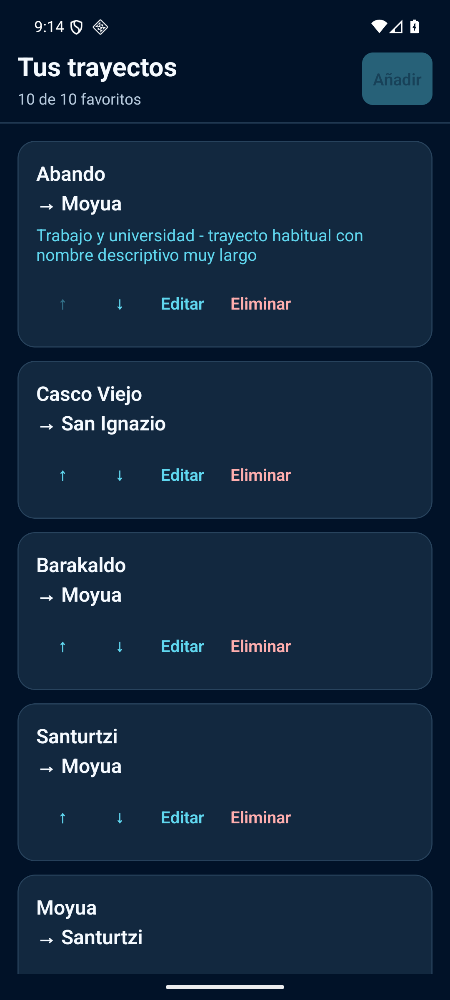
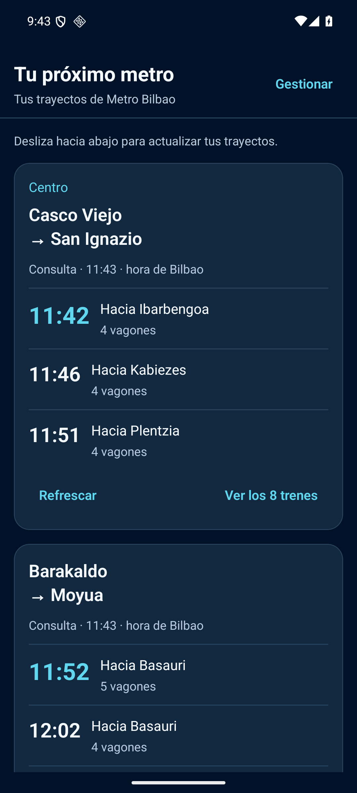
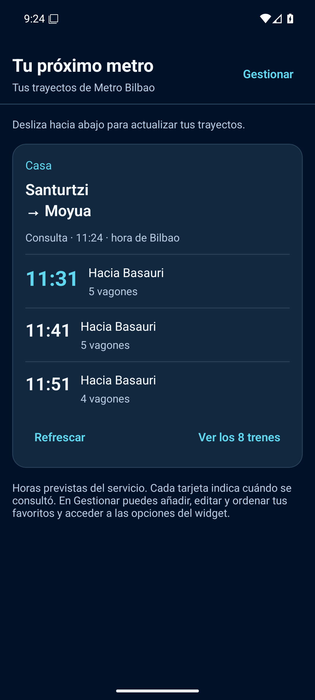
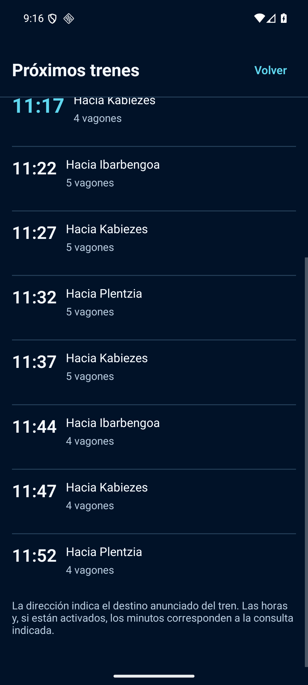

# AndroidMetro 2.0 · App de consulta con favoritos

10 de octubre de 2026. Rama local `feature/app-consulta-trayectos`, derivada de la fase 1 publicada (`e61da22`). No se hace push, merge ni release en esta tarea. `main` permanece en `339def20985e0fc2f2493ed593836472c96240b5`.

## Diseño y alcance

La home de fase 1 era un gestor: rutas y botones de subir, bajar, editar y eliminar. La versión original consultaba trenes junto a los formularios de cuatro paneles. Se recupera la consulta directa con una separación sencilla:

- **Tu próximo metro:** tarjetas de favoritos en su orden guardado. Alias opcional, origen y destino, hora de consulta en Bilbao, horas previstas, dirección anunciada y vagones según preferencias. El próximo tren tiene más peso visual.
- **Detalle:** botón de cada tarjeta abre la lista desplazable de **todos** los resultados. Tres filas son solamente la vista previa de la home; no se recorta la respuesta ni se limita el widget. Alias completo en el detalle; máximo dos líneas en la tarjeta.
- **Gestionar:** pantalla secundaria reutiliza el editor, validación, confirmación de borrado y orden de la fase 1. Allí permanecen las opciones del widget, plegadas inicialmente. Volver o Atrás devuelve a la consulta; Atrás no cierra gestión durante un guardado.

Esta opción evita duplicar los formularios o añadir una biblioteca de navegación. Dos modales nativos cubren detalle y gestión. No hay mapa, cuentas ni nuevas dependencias. Una app sin widgets permite crear favoritos y consultar trenes por el mismo recorrido; el widget es opcional.

## Arquitectura reutilizada

`App.js` abre `ConsultationScreen`. El registro del handler y de `ConfigScreen` como actividad de configuración del widget se conserva.

`consultationController.js` coordina solamente la consulta de la app. Lee `favoritesRepository` y `trainService`, sin alterar sus claves, esquema, migración, validación, caché, estados de error ni selecciones de widgets. Los favoritos siguen siendo compartidos y cada instancia conserva su selección independiente.

- Caché por ruta al entrar; consulta si falta, tiene error o supera 30 segundos. Volver desde gestión relee favoritos y preferencias. No consulta por cambiar únicamente un alias si la caché es reciente.
- Máximo tres consultas simultáneas. El servicio ya deduplica solicitudes en curso y reutiliza respuestas durante 2,5 segundos.
- Refresco individual y actualización de todas las tarjetas deslizando hacia abajo.
- Una generación de pantalla y la clave origen/destino descartan respuestas tardías después de editar, eliminar o dejar la pantalla. No mezclan trenes de otra ruta.
- Al pasar a segundo plano se dejan de iniciar consultas en cola. Las que ya están en curso terminan con el timeout existente de diez segundos y pueden actualizar la caché, pero no una pantalla inactiva. No hay consultas periódicas ni trabajo adicional en segundo plano.
- El aviso de datos antiguos aparece a partir de dos minutos, o inmediatamente tras un error con caché. Su antigüedad se repinta cada 30 segundos mientras la consulta está visible; ese temporizador **no consulta la API**.
- Un fallo conserva solamente la última consulta de esa ruta, con aviso. Una respuesta vacía válida sustituye la lista anterior. No se confunde ausencia de trenes con fallo de red.
- `timeRounded` sigue siendo la hora prevista que devuelve la API. Los minutos opcionales son `estimated` normalizado por el servicio y están rotulados «al consultar». No se inventan timestamps ni contadores. La hora de consulta corresponde al reloj del dispositivo, no a un timestamp del proveedor.

No se modifica `src/widgets/`, el modelo, el repositorio, el servicio de API, las estaciones, Expo config, assets del icono ni `package-lock.json`. Los cambios pequeños en `ConfigScreen` son textos, retorno a consulta y aviso de operación en curso hacia la pantalla padre; el flujo de configuración nativa conserva sus props anteriores.

## Comparativa visual real

Capturas del emulador, sin alterar píxeles. Los horarios son consultas reales puntuales; no representan horarios garantizados. La barra Android está en UTC y la consulta muestra explícitamente hora de Bilbao.

| Antes: administración como home | Después: consulta directa |
|---|---|
|  |  |

| App sin widgets | Detalle con todos los trenes |
|---|---|
|  |  |

Otras evidencias: [fuente 150 %](evidencias/app-consulta/05-home-fuente150.png), [detalle 150 %](evidencias/app-consulta/06-detalle-fuente150.png), [gestión secundaria](evidencias/app-consulta/07-gestion-secundaria.png), [sin conexión](evidencias/app-consulta/14-sin-conexion.png), [recuperación](evidencias/app-consulta/15-conexion-recuperada.png), [estado vacío sin widget](evidencias/app-consulta/23b-solo-app-vacio.png), [duplicado bloqueado](evidencias/app-consulta/26-duplicado-bloqueado.png), [opciones del widget](evidencias/app-consulta/27-opciones-secundarias.png).

## Compilación y artefacto

Se utiliza el entorno aislado de recuperación, sin cambios: Expo 55.0.2, RN 0.83.2, widget 0.20.1, JDK 17.0.20.1+1, SDK/build-tools 36, NDK 27.1.12297006, Gradle 9.0.0 y lockfile existente.

```powershell
$env:NODE_ENV = 'production'
./scripts/compilar-pruebas.ps1
Copy-Item -LiteralPath android/app/build/outputs/apk/release/app-release.apk -Destination "$env:USERPROFILE/AMetro/artifacts/androidmetro-app-consulta-test.apk"
& "$env:USERPROFILE/AMetro/sdk/platform-tools/adb.exe" -s emulator-5556 install -r "$env:USERPROFILE/AMetro/artifacts/androidmetro-app-consulta-test.apk"
```

Prebuild se ejecuta sin `--clean`. El script exige el applicationId de pruebas y usa exclusivamente su keystore aislado. Nunca instalar esta compilación sobre la app original.

APK autónomo local: `C:/Users/W11/AMetro/artifacts/androidmetro-app-consulta-test.apk`.

- 62.831.276 bytes; SHA-256 `685aa78702b3faa91f4aaf8207c66725f374067f44def936598eb3bd67b4e92e`.
- `com.metrobilbao.widget.pruebas`, versionName 1.0.0 / versionCode 1; minSdk 24, target/compile 36.
- Certificado SHA-256 `5822756d7982c9c612d283f007d55f08e62b7a4224cc9b5b9409b1297891026d`: firma exclusiva de pruebas existente, sin tocar credenciales de distribución.
- Bundle Hermes integrado de 1.101.396 bytes. Los 196 recursos raster Android tienen los mismos hashes por contenido que el APK de fase 1: icono minimalista conservado.
- El APK de fase 1 y los APK de recuperación permanecen separados. Ningún APK, keystore, log local ni dependencia generada se versiona.

## Validación

Emulador AndroidMetro_API36, API 36 Google APIs x86_64, Pixel 6, 1080×2400/420 dpi. Siempre `adb -s emulator-5556`; no se utiliza el móvil principal. Usuario 0 conserva los diez favoritos y widgets de fase 1. Usuario secundario 10 «MetroSoloApp» es un perfil de prueba sin widgets, con datos propios.

| Prueba | Evidencia / resultado |
|---|---|
| Consulta al abrir | Trenes reales en tarjetas sin entrar en gestión; 02, 08 y 13. |
| Lista completa | Ocho horas diferentes recorridas en detalle de ABA/MOY, incluyendo filas 7 y 8: 04. El controlador conserva además 24 filas en prueba simulada. |
| Alias / texto grande | Alias de 75 caracteres, home y detalle al 150 %, sin solapamientos observados: 05–06. Alias corto «Trabajo» tras editar: 08. Escala restaurada a 100 %. |
| Edición y orden | ABA/MOY cambiado a ABA/ANS y restaurado con validación real de API: 10. CAV/SIN pasa a primera tarjeta al bajar favorito ABA/MOY; subir restaura orden. |
| Borrado / creación / diez | Cancelar conserva favorito; confirmar libera capacidad; crear ABA/MOY vuelve a diez y deshabilita Añadir: 11–12 en registro bruto. |
| Duplicados | Intento STZ/MOY duplicado bloqueado antes de guardar: 26. |
| Refresco y red | Error explícito con Wi-Fi/datos desactivados y caché anterior: 14. Restaurar conexión y refrescar recupera datos: 15. Deslizar consulta todas las tarjetas: 16 en registro bruto. |
| Uso sin widget | Usuario 10 vacío → crear Casa STZ/MOY → tarjeta y detalle con API real, sin añadir widget: 23b–25. |
| Preferencias | Vagones se ocultan/reaparecen en la app; minutos aparecen como estimación al consultar: 27–28. Se restaura modo horas. |
| Widget | Validación final y reinicio registrados en resultados-ui.json y capturas 18–22 / 29–31. Se conservan las selecciones independientes y las colecciones desplazables. |
| Persistencia | Validación de reinicio Android en registro y capturas finales. |
| APK autónomo / icono | Inicio COLD en usuario nuevo sin Metro escuchando en 8081, bundle integrado y recursos idénticos a fase 1. |

Registro: [resultados-ui.json](evidencias/app-consulta/resultados-ui.json). Árboles uiautomator, capturas adicionales y logs de build quedan en `C:/Users/W11/AMetro/evidencias/app-consulta` y su directorio padre. Las capturas 02–12 corresponden al primer APK; 13–32 al segundo, que añade el repintado de antigüedad y protección de Atrás al guardar; 33–35 al APK definitivo, que además comparte el límite de tres consultas entre refrescos manuales, lotes automáticos y generaciones de pantalla. El modelo, consultas, CRUD y diseño son los mismos. Los intentos prematuros del automatizador están anotados y no se presentan como pruebas positivas. Tras reiniciar Android apareció un recorte de la barra de estado tanto en la app como en el launcher: era un artefacto de SystemUI del emulador. Reiniciar solamente ese proceso corrigió el recorte. Se volvió a entrar/salir de gestión y detalle sin reproducirlo; captura final 38, sin modificar el código ni el APK.

Pruebas automatizadas, datos simulados exclusivamente en scripts:

```powershell
node scripts/test-consultation.cjs
node scripts/test-fase1.cjs
node scripts/test-persistence-api.cjs
node scripts/test-widget-races.cjs
```

Pasan: respuestas tardías tras editar, eliminación, pausa de pantalla, caché reciente / retorno, refresco, errores y vacío, concurrencia máxima tres, diez favoritos y 24 filas; además regresiones de migración, persistencia, validación, caché/API y aislamiento de widgets.

## Cambios y continuación

- `App.js`: consulta como entrada normal, registros de widget conservados.
- `src/screens/ConsultationScreen.js`: home, detalle, gestión secundaria y estados visibles.
- `src/services/consultationController.js`: coordinación de consultas de la app.
- `src/screens/ConfigScreen.js`: retorno a home, textos coherentes con ambos usos y protección durante operaciones.
- `scripts/test-consultation.cjs`: pruebas significativas de concurrencia y ciclo de vida.
- Esta documentación y capturas seleccionadas.

Commits de implementación: `fdaf394` (coordinación/caché/pruebas), `f3cdd87` (home/detalle/gestión secundaria). 552fa53 limita también consultas manuales y anteriores en curso; pruebas específicas pasan. Documentación y evidencias se guardan en un commit separado posterior.

## Límites y decisiones pendientes

No hay bloqueos de producto para este alcance. Se eligen tres trenes de vista previa y lista completa en detalle, sin auto-refresco periódico. Las preferencias existentes de vagones/minutos se comparten entre app y widget para no duplicar ajustes. Estos criterios son revisables sin migrar datos.

Pendientes: móvil físico, otros launchers y Android antiguos, TalkBack completo, fuentes superiores al 150 %, medición de red/batería durante días, listas API reales mayores que las ocho filas observadas y entrega periódica de widgets bajo Doze. No se afirma haber probado estos casos. La compatibilidad nominal sigue minSdk 24, pero la prueba real de este rediseño es API 36.

El reloj del dispositivo determina la hora de consulta. Sin contrato temporal verificado del servicio no se puede afirmar un contador exacto ni que una salida prevista siga disponible una vez envejecen los datos. La app mantiene hora, aviso y refresco explícito; no se añaden planificador ni cambios de widget.
