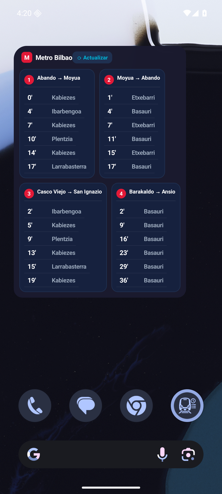
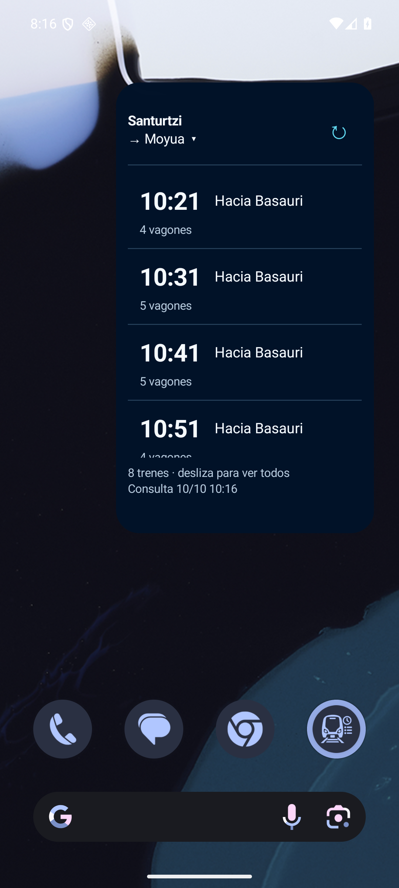
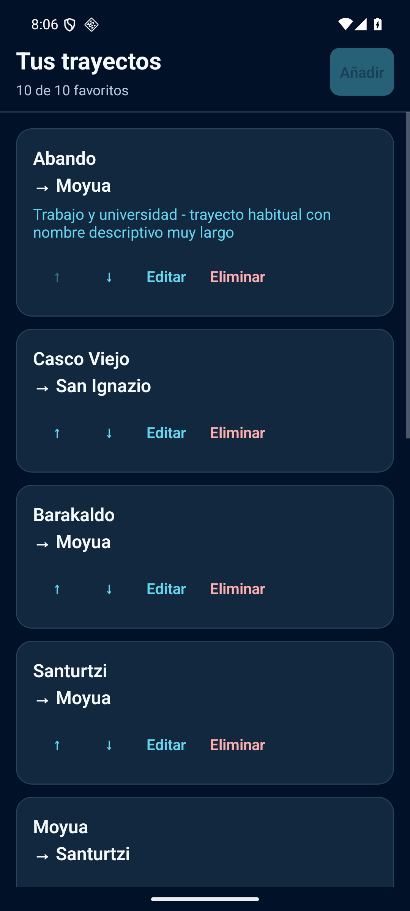
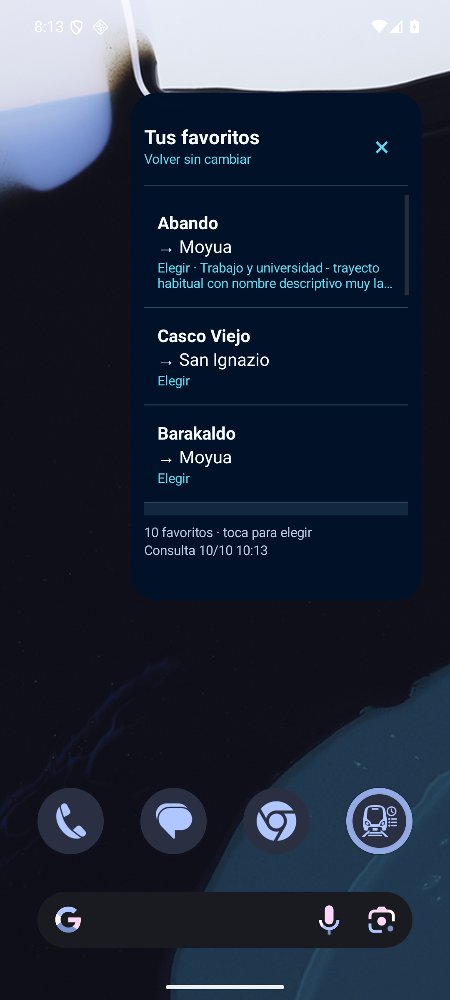

# Capturas reales — AndroidMetro 2.0, fase 1

API y emulador reales, 10 de octubre de 2026. Sin datos simulados en estas capturas. El emulador conserva UTC en su barra de estado; las horas del servicio y de consulta se presentan en Europe/Madrid. El APK de pruebas está separado de la aplicación original.

| Evidencia | Qué demuestra |
|---|---|
| [Widget anterior, fase B](evidencias/icono-widget-refresco.png) | Cuatro paneles, icono minimalista ya validado. |
| [Widget nuevo compacto](evidencias/fase1/03-widget-compacto.png) | Ruta única, trenes desplazables, vagones opcionales y consulta. |
| [Configuración](evidencias/fase1/02-configuracion.png) | Diez favoritos guardados después de reiniciar Android, alias y controles de edición/orden. |
| [Selector](evidencias/fase1/04-selector.png) | Trayectos, alias y selección dentro del widget. |
| [Ampliado al 150 %](evidencias/fase1/05-widget-grande150.png) | Tipografía ampliada, pie de consulta visible. |
| [Alias largo al 150 %](evidencias/fase1/06-alias150.png) | Estaciones visibles y alias con elipsis, sin desplazar el refresco. |
| [Últimos trenes](evidencias/fase1/07-lista-completa.png) | Lista desplazada hasta el final; acceso a trenes posteriores, sin limitarlos a seis. |
| [Sin conexión, con caché](evidencias/fase1/08-sin-red-cache.png) | Error distinguido de resultado válido y datos anteriores identificados. |
| [Sin conexión, sin caché](evidencias/fase1/09-sin-red-sincache.png) | Error sin mostrar trenes del trayecto anterior. |
| [Reinicio, instancia 1](evidencias/fase1/10-reinicio-instancia1.png) / [instancia 2](evidencias/fase1/11-reinicio-instancia2.png) | Rutas distintas restauradas antes de abrir la app. |
| [Preferencias](evidencias/fase1/12-preferencias.png) | Vagones y minutos al consultar, compartidos por los widgets. |
| [Selector al 150 %](evidencias/fase1/13-selector150.png) | Lista con etiquetas amplias, alias y selección. |

## Comparación: widget anterior y nuevo

## App y selector

El registro de resultados está en [resultados-ui.json](evidencias/fase1/resultados-ui.json). Los árboles UI originales y todos los intentos, incluidos los no válidos, se conservan fuera de Git en `C:/Users/W11/AMetro/evidencias/fase1`.

## Repetir la validación manual

Usar únicamente `emulator-5556` con la variante `com.metrobilbao.widget.pruebas`. Instalar con `install -r`, abrir la app y añadir los widgets desde Nexus Launcher. No borrar datos para comprobar migración o persistencia. Las pruebas de migración requieren el APK de fase B y sus cuatro rutas como punto de partida; volver a instalar un APK antiguo no revierte los datos ya migrados.

1. Crear rutas distintas hasta diez; probar alias largo, edición de estaciones, intercambio, flechas de orden y duplicado. Confirmar y cancelar un borrado. Un fallo de red al validar una ruta nueva debe conservar el borrador y bloquear el guardado.
2. Añadir dos widgets. Elegir rutas diferentes con Listo. Abrir el selector, elegir otra ruta y cerrar sin elegir; comprobar que la otra instancia no cambia. Editar desde la app una ruta seleccionada y comprobar el cambio automático.
3. Refrescar y recorrer la lista hasta la última fila. Comparar con el total indicado: todos los resultados deben seguir accesibles. Deslizar dentro del área de la lista; para cambiar de página del launcher, deslizar fuera del widget.
4. Desactivar Wi-Fi y datos del emulador, refrescar una ruta con caché y comprobar el aviso. Para el caso sin caché se necesita una ruta migrada aún no consultada o un emulador de pruebas separado preparado para ese caso. Restaurar red y refrescar. No modificar ni interceptar el proveedor real.
5. Probar texto 100 % y 150 % en Ajustes Android, app, editor, selector, alias y trenes. Redimensionar al tamaño compacto y ampliado admitidos por el launcher; comprobar el pie y desplazamiento. Restaurar después escala100.
6. Cerrar la app normalmente y refrescar el widget. Reiniciar Android; inspeccionar ambas rutas antes de abrir la app y después comprobar los diez favoritos, orden y alias. Force Stop es una prueba aparte: en Android15+ se debe abrir la app para recuperar las acciones canceladas por el sistema.

No existe un modo de datos ficticios en la aplicación. Vacío válido, fallos HTTP/formato/timeout y carreras de respuestas se ejercitan mediante los scripts Node aislados descritos en ANDROIDMETRO_2_FASE1.md.
